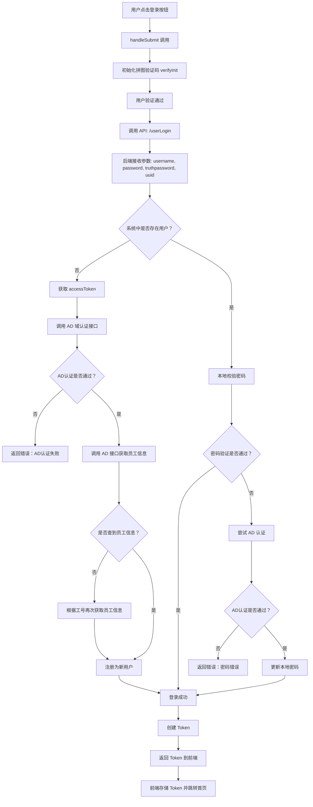
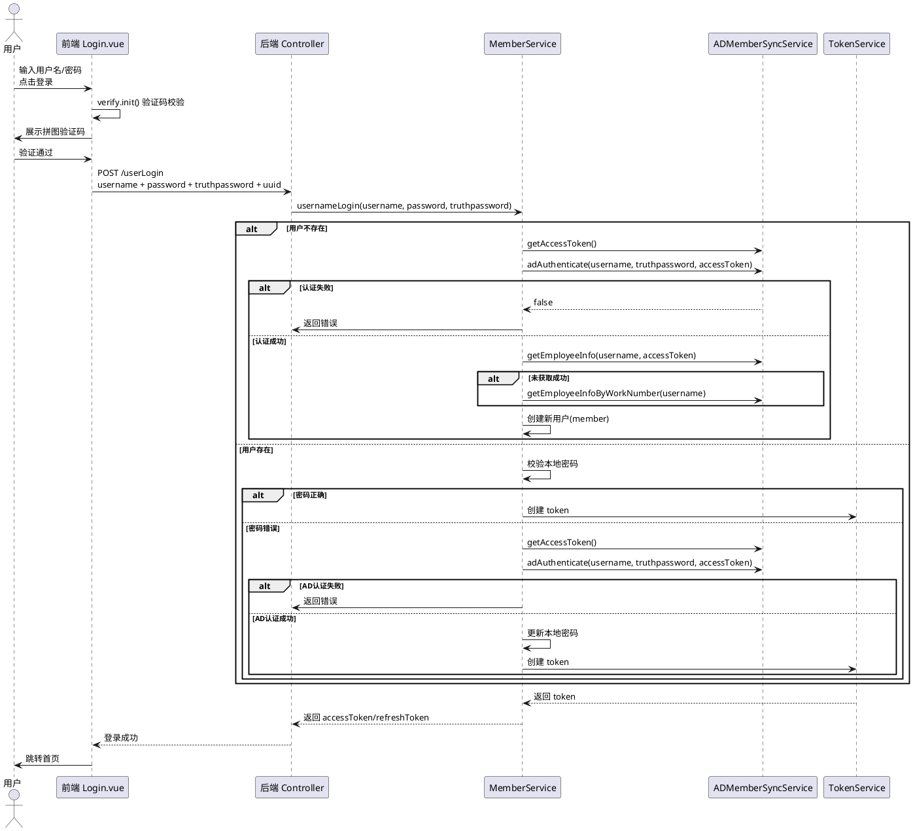

---

# 企业统一登录流程图文解析（含 Mermaid 与 PlantUML 可视化）

本文结合前后端实现代码，对一个集成了**拼图验证码**与**AD域认证**的账号密码登录流程进行可视化说明。我们分别使用 **Mermaid** 与 **PlantUML** 进行时序图与流程图的绘制，以便于开发团队理解整体业务流程。

---

## 🧩 登录流程概览

用户通过前端页面提交账号密码，系统先进行拼图验证，再根据是否为系统已有用户决定走本地校验或 AD 域认证，并最终完成 token 的生成与登录跳转。

---

## 📊 Mermaid 流程图（简洁结构）

> ✅ 建议使用支持 Mermaid 的 Markdown 编辑器（如 Typora、Obsidian、VS Code 插件）进行渲染。  
> 

---

## ⏱ PlantUML 时序图（完整调用关系）

> ✅ 可通过 [PlantUML Live](https://www.plantuml.com/plantuml/) 或 VS Code 插件进行可视化。  
>   
> 

---

## 🔎 总结

- 登录流程中使用了 **双重校验机制**：先本地密码校验，再补偿性调用 AD 域认证。
- 用户不存在时，也能通过 AD 信息自动建档，做到「无缝引导入系统」。
- 图表工具如 **Mermaid** 更适合概览类展示，**PlantUML** 则适合详细链路跟踪。

---
